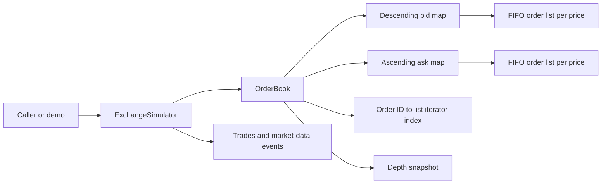

# LOB Terminal — C++20 Limit Order Book

**Live dashboard:** [Open LOB Terminal](https://qivoxe-limit-order-book-dashboardapp-kpcjuq.streamlit.app/)

A low-latency systems research project exploring exchange matching mechanics, price-time priority, indexed cancellation, market-data events, and measurement discipline. The matching engine is implemented in C++20; the Streamlit dashboard is a visualization and control surface over the real C++ process, not a second Python matcher.

> **Scope:** This is an educational and research portfolio project—not a production exchange, execution venue, or guarantee of production HFT performance. Benchmark results are synthetic and machine-dependent.

| Area | Implementation |
|---|---|
| Matching | Price-time priority, FIFO at each price, resting-order price execution, partial and full fills |
| Book structure | Ordered bid/ask price maps, per-level FIFO lists, aggregate quantities, order-ID location index |
| Market data | Owned depth snapshots and synchronous typed trade, level, and quote events |
| Dashboard | Streamlit + Plotly, backed by a persistent local C++ adapter process |
| Toolchain | C++20, CMake, Ninja, GoogleTest; Python dashboard tests |

## Performance snapshot

Five synthetic Release runs on GCC 15.2.0 / an Intel Core i3-1305U / WSL2 reported median throughput of **13.36M single-price submissions/s** and **112.4M best/level queries/s**. Across those runs, median single-submit latency percentiles were **66 ns p50**, **137 ns p99**, and **290 ns p99.9**. These are local observations—not service-level objectives or portable performance claims. Workload definitions, observed ranges, and measurement caveats are documented in [Benchmarks](#benchmarks).

## What it demonstrates

At each price, orders rest in arrival order. A new order trades against the best eligible opposing price first; orders at that price are consumed FIFO. Executions use the resting order's price. A remainder rests on the book as a limit order. Cancellation removes the requested resting order without scanning its queue.

Implemented features include limit-order submission, partial and full fills, trade generation, duplicate and invalid-order rejection, cancellation, best bid/ask, per-price aggregate quantities, bounded market-depth snapshots, and synchronous typed market-data events. IDs must be unique while resting; an ID becomes reusable after cancellation or full fill.

## Architecture

- `include/lob/order.hpp` defines order identifiers, integer tick prices, quantities, sides, and orders.
- `include/lob/market_data.hpp` defines trades, depth snapshots, and typed event/result structures.
- `include/lob/order_book.hpp` and `src/order_book.cpp` implement the matching engine and read-only book queries.
- `include/lob/exchange_simulator.hpp` provides a small synchronous interface around the order book.
- `src/main.cpp` is a deterministic demonstration executable.
- `tests/` contains GoogleTest coverage; `benchmarks/` contains synthetic throughput and latency programs.

The book uses descending `std::map` levels for bids and ascending `std::map` levels for asks. Each level holds a FIFO `std::list<Order>` and aggregate quantity. An `std::unordered_map<OrderId, OrderLocation>` stores each resting order's side, price, and list iterator for expected constant-time index lookup followed by a price-map lookup and constant-time list erase.



## Build and run

On Ubuntu or WSL, install the compiler, build tools, and test dependency:

```sh
sudo apt update
sudo apt install -y build-essential cmake ninja-build libgtest-dev
```

Build and run tests in a normal Debug configuration:

```sh
cmake -S . -B build -G Ninja -DCMAKE_BUILD_TYPE=Debug
cmake --build build
ctest --test-dir build --output-on-failure
./build/lob_engine
```

Build without GoogleTest or benchmark dependencies/targets (the simulator demo can also be disabled):

```sh
cmake -S . -B build-core -G Ninja -DBUILD_TESTING=OFF -DLOB_BUILD_BENCHMARKS=OFF -DLOB_BUILD_DEMO=OFF
cmake --build build-core --target lob
```

Build and run the AddressSanitizer/UndefinedBehaviorSanitizer suite:

```sh
cmake -S . -B build-sanitize -G Ninja -DCMAKE_BUILD_TYPE=Debug -DBUILD_TESTING=ON -DLOB_BUILD_BENCHMARKS=OFF -DCMAKE_CXX_FLAGS="-fsanitize=address,undefined -fno-omit-frame-pointer" -DCMAKE_EXE_LINKER_FLAGS="-fsanitize=address,undefined"
cmake --build build-sanitize
ASAN_OPTIONS=detect_leaks=0 ctest --test-dir build-sanitize --output-on-failure
```

`detect_leaks=0` was needed in the tested WSL environment because LeakSanitizer failed during test discovery with a ptrace-related error. AddressSanitizer and UndefinedBehaviorSanitizer remain enabled. On environments where LeakSanitizer works, omit that environment setting.

Build and run Release tests and synthetic benchmarks:

```sh
cmake -S . -B build-release -G Ninja -DCMAKE_BUILD_TYPE=Release
cmake --build build-release
ctest --test-dir build-release --output-on-failure
./build-release/lob_engine
./build-release/lob_benchmark
./build-release/cancellation_benchmark
```

`BUILD_TESTING` controls GoogleTest targets. `LOB_BUILD_BENCHMARKS` and `LOB_BUILD_DEMO` independently control benchmark and demo executables. Common warnings are enabled by default for the core library (`-Wall -Wextra -Wpedantic` for GCC/Clang, `/W4` for MSVC); set `LOB_ENABLE_WARNINGS=OFF` to disable them.

## Streamlit dashboard

The `dashboard/` application presents a local trading-terminal view backed by the real C++ engine. It builds `lob_protocol` with the normal CMake targets; Python communicates through a versioned, line-framed TSV subprocess protocol. No separate Python matching logic or market data is used. Prices are displayed as integer ticks, and the simulation is scoped to the active Streamlit session.

Create a Python virtual environment and install the small dashboard dependency set:

```sh
python3 -m venv .venv
source .venv/bin/activate
python -m pip install -r dashboard/requirements.txt
```

Build the Release app and run C++ and Python checks:

```sh
cmake -S . -B build-release -G Ninja -DCMAKE_BUILD_TYPE=Release
cmake --build build-release --parallel
ctest --test-dir build-release --output-on-failure
LOB_PROTOCOL_EXECUTABLE="$PWD/build-release/lob_protocol" python -m unittest discover -s dashboard -p 'test_*.py' -v
```

Launch with `python -m streamlit run dashboard/app.py`. For complete setup, protocol details, features, and limitations, see `dashboard/README.md`.

## Market-data interface

`OrderBook::depth_snapshot(n)` returns owned vectors of up to `n` levels on each side. The snapshot does not expose mutable internal levels. A zero-depth request and an empty book return empty vectors.

`ExchangeSimulator::submit_limit_order` returns an acceptance flag, trades, and synchronous events. Event order for one accepted submission is: trades in execution order; changed price levels ordered by side (`Buy`, then `Sell`) and ascending price; then one best-quote event if either best price changed. Removed-level events carry zero quantity and order count. A successful cancellation returns its level update/removal followed by a quote event only when the best quote changed. Rejected and unknown-ID operations return no events. Events are return values, not a durable queue or network feed.

## Benchmarks

`lob_benchmark` reports one timing per workload; repeat the executable for run-to-run variability. Each workload's API-operation count is shown in output:

| Workload | Timed work and verification |
|---|---|
| Single price | 100,000 sell/buy pairs (200,000 submissions); one full trade per pair; empty final book. |
| Event-enabled | Same pairs and count, using `submit_order_with_events`; validates accepted requests and trade/event production; empty final book. |
| 32 price levels | 10,000 batches of 32 resting asks plus one consuming buy (330,000 submissions; 320,000 trades). |
| Partial/multi-order | 10,000 batches of eight resting adds, one partial-fill submission, and four cancels (130,000 API calls). |
| Cancellation | 100,000 cancellations; order setup and ID-vector allocation are outside the timed interval. |
| Non-crossing accumulation | 100,000 non-crossing submissions; checks count and best bid. |
| Best/level queries | 250,000 iterations of best bid, best ask, bid quantity, and ask quantity (1,000,000 queries); setup excluded. |
| Mixed | 50,000 iterations of two adds, one partially matching submission, and two cancellations (250,000 API calls). |

Latency samples time one incoming buy submission against a preloaded one-lot ask. Ask setup and validation are outside the measured interval; each run takes 50,000 samples using `steady_clock`. The reported maximum is only the largest observed sample. Per-operation clock reads, result-vector work, scheduling, CPU frequency changes, and virtualization affect measurements.

Recorded on GCC 15.2.0, CMake Release, an Intel Core i3-1305U in WSL2. Five Release runs after the simulator overflow preflight change gave these medians and observed ranges:

| Workload | Median throughput | Observed range |
|---|---:|---:|
| Single-price submissions | 13.36M submissions/s | 7.24–20.66M |
| Event-enabled submissions | 4.14M submissions/s | 3.38–5.99M |
| 32-level submissions | 5.07M submissions/s | 3.74–7.05M |
| Partial/multi-order API calls | 20.31M calls/s | 15.06–25.55M |
| 100,000 cancellations | 11.07M cancellations/s | 6.11–21.51M |
| Non-crossing submissions | 4.55M submissions/s | 1.41–4.78M |
| Best/level queries | 112.4M queries/s | 104.0–209.6M |
| Mixed API calls | 22.21M calls/s | 14.21–29.93M |

Across the five latency runs, percentile medians were p50 66 ns, p90 118 ns, p95 120 ns, p99 137 ns, and p99.9 290 ns. The median of the run-specific sample maxima was 266,415 ns. WSL run-to-run variability was substantial; `perf stat` could not access hardware events in this environment. The event-enabled workload has lower throughput because it pre-scans eligible levels and constructs trade, level, and quote results. These synthetic measurements do not establish production HFT performance and should not be compared with runs that use different operation counts or timing scopes.

## Limitations and future work

- This is a single-threaded in-memory simulator. It has no persistence, recovery, networking, exchange connectivity, or concurrent-access guarantees.
- Events are synchronous return values. There is no sequenced/durable feed, backpressure policy, or replay protocol.
- The legacy `OrderBook::submit_order` returns only a trade vector, so an empty vector does not distinguish rejection from a valid non-crossing submission. The simulator result API provides an acceptance flag.
- Allocation failure during matching or market-data result construction does not provide a transaction-wide rollback guarantee; a caller may not receive a complete result after some state changes.
- Tests include a fixed-seed randomized add/cancel invariant test and deterministic matching/event tests. There is not yet a randomized reference matcher covering arbitrary mixed matching flows.
- WSL profiling and timing variability limit conclusions about allocator, cache, or instruction-level bottlenecks.

Potential follow-up work includes a deterministic order-flow replay format, an independent randomized matching reference model, allocation-failure tests, and profiling on a host with supported performance counters.
